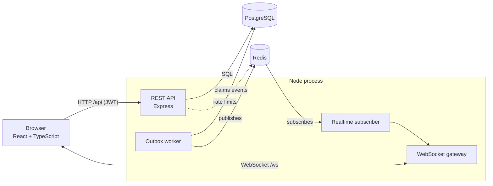

# CollabSpace

[](https://github.com/Keshav0452/CollabSpace/actions/workflows/ci.yml)


A team workspace for planning and tracking work. Teams organise tasks into projects, assign them to
several people at once, discuss them in comments, and get notified instantly when something that
concerns them changes.

**Highlights**

- Workspaces with owner, admin and member roles
- Tasks with several assignees, priorities, due dates, projects, search, filters and pagination
- Comments and a full activity history on every task
- Live notifications over WebSockets, backed by a transactional outbox so none are lost
- Invite people with expiring, revocable invite links
- Hardened by default: rate limiting, token revocation, security headers, strict input validation
- One command to run everything with Docker Compose, with an end-to-end test suite and CI

## Table of contents

- [Features](#features)
- [Architecture](#architecture)
- [Tech stack](#tech-stack)
- [Getting started](#getting-started)
- [Configuration](#configuration)
- [Project structure](#project-structure)
- [API overview](#api-overview)
- [Roles and permissions](#roles-and-permissions)
- [Security](#security)
- [Testing](#testing)
- [Deployment](#deployment)
- [Documentation](#documentation)
- [Known limitations](#known-limitations)

## Features

| Area | What you get |
|---|---|
| **Accounts** | Register, log in, edit profile, change password. A password change signs out every other session immediately. |
| **Workspaces** | Create several workspaces, switch between them, rename them. Every workspace has its own members, projects and tasks. |
| **Members and roles** | Add registered users by email, change roles, remove members. Owner, admin and member roles with enforced limits. |
| **Invite links** | Owners and admins create links that expire after 1 to 30 days and can be limited to a number of uses. Links can be revoked. New users with no workspace can paste a link to join. |
| **Projects** | Group related tasks. Archive and reactivate projects. Deleting a project keeps its tasks. |
| **Tasks** | Title, description, status, priority, due date, project, and up to 20 assignees. Search across the workspace, filter by status, project or assignee, paginate. |
| **Comments and activity** | Discuss a task. Only the author can edit or delete a comment. Every change is recorded with who made it. |
| **Notifications** | Assignment, status-change and comment notifications with read/unread state and links to the task. They arrive live, without a refresh. |
| **Dashboard** | A summary of the workspace and its recent tasks. |

## Architecture



**How a live notification travels.** When someone assigns a task, the API writes the task, the
notification and an *outbox event* in a single database transaction, then returns. A background worker
claims pending events and publishes them to a Redis channel. A subscriber checks that the recipient is
still a workspace member and pushes the event to their open WebSocket connections. The browser then
refetches the affected data. Because the event is stored before it is published, it survives a Redis
outage or a server restart, and failed events are retried with backoff.

A visual walkthrough with a test script is in [`docs/architecture.html`](docs/architecture.html).

## Tech stack

| Layer | Technology |
|---|---|
| Frontend | React 19, TypeScript, Vite, React Router, TanStack Query |
| Backend | Node.js 22, Express 5, TypeScript, Zod validation |
| Database | PostgreSQL 16 with plain SQL migrations (`node-pg-migrate`) |
| Realtime | Redis 7 pub/sub, `ws` WebSocket server, transactional outbox |
| Auth | Argon2 password hashing, signed JWT access tokens (`jose`), per-user token versioning |
| Testing | Vitest, Supertest, end-to-end API and WebSocket tests, GitHub Actions CI |
| Packaging | Docker, Docker Compose, Nginx |

## Getting started

### Option A: Docker Compose (quickest)

Requirements: Docker with the Compose plugin.

```bash
cp .env.example .env
# Edit .env: set DB_PASSWORD and JWT_SECRET (see "Configuration")
docker compose up --build -d
```

Open http://localhost:8080. The backend waits for PostgreSQL and Redis, applies database migrations
automatically, and then starts. Useful commands:

```bash
docker compose logs -f backend frontend   # follow logs
docker compose down                        # stop, keep data
docker compose down -v                     # stop and DELETE the database (destructive)
```

### Option B: local development

Requirements: Node.js 22, PostgreSQL 16+, Redis 7+.

**1. Create the database** (choose your own password):

```sql
CREATE ROLE collabspace_app LOGIN PASSWORD 'replace-with-your-password';
CREATE DATABASE collabspace OWNER collabspace_app;
```

**2. Start the backend**

```bash
cd backend
cp .env.example .env     # then edit .env with your database password and a JWT secret
npm ci
npm run migrate:up
npm run dev              # http://localhost:3000
```

**3. Start the frontend** (in another terminal)

```bash
cd frontend
npm ci
npm run dev              # http://localhost:5173 (proxies /api and /ws to the backend)
```

### Try it

1. Open http://localhost:5173 and register an account.
2. Create a workspace, then a project and a few tasks.
3. Open **Members**, create an invite link, and open it in a private window to join as a second user.
4. Assign a task to the second user and watch their notification bell update live.

[`TESTING.md`](TESTING.md) is a complete walkthrough of every feature.

## Configuration

Copy `.env.example` to `.env` (root, for Docker) or `backend/.env.example` to `backend/.env` (local).

| Variable | Required | Default | Description |
|---|---|---|---|
| `DB_HOST`, `DB_PORT`, `DB_NAME`, `DB_USER` | yes | | PostgreSQL connection |
| `DB_PASSWORD` | yes | | PostgreSQL password. Use a long random value. |
| `REDIS_URL` | yes | `redis://127.0.0.1:6379` | Redis connection |
| `JWT_SECRET` | yes | | Signing key for access tokens. At least 32 characters. The server refuses to start otherwise. |
| `PORT` | no | `3000` | Backend port |
| `TRUST_PROXY` | no | `false` | Number of reverse proxies in front of the backend: `1` for nginx only, `2` for an HTTPS proxy in front of nginx. Controls the client IP used for rate limiting. |
| `ACCESS_TOKEN_TTL_HOURS` | no | `24` | How long a login lasts without activity. Active users are renewed automatically. |
| `API_RATE_LIMIT_PER_MINUTE` | no | `600` | Per-IP ceiling for the whole API |
| `APP_PORT` | no | `8080` | Host port for Docker Compose |

Generate strong secrets with `openssl rand -base64 48`. Never commit `.env`.

## Project structure

```
collabspace/
├── backend/
│   ├── src/
│   │   ├── modules/          # One folder per feature: routes, controller, service, repository, validation
│   │   │   ├── auth/  workspaces/  invites/  projects/  tasks/
│   │   │   ├── comments/  notifications/
│   │   │   ├── outbox/       # Transactional outbox worker
│   │   │   └── realtime/     # Redis subscriber + WebSocket gateway
│   │   ├── middleware/       # Auth, validation, rate limiting, error handling
│   │   ├── config/           # PostgreSQL and Redis clients
│   │   └── app.ts, server.ts
│   ├── migrations/           # Versioned SQL migrations
│   └── tests/                # Unit tests, plus tests/e2e for end-to-end tests
├── frontend/
│   └── src/
│       ├── features/         # Screens grouped by feature
│       ├── components/       # Layout and shared UI
│       ├── context/          # Auth, workspace, toast and realtime state
│       └── api/              # Typed API client
├── docs/                     # Architecture walkthrough
├── docker-compose.yml        # PostgreSQL, Redis, backend, frontend (Nginx)
└── .github/workflows/        # CI
```

## API overview

All routes are under `/api`. Everything except register, login and the health checks needs an
`Authorization: Bearer <token>` header. Errors use `{ "status": "error", "message": "..." }`.

| Area | Endpoints |
|---|---|
| **Auth** | `POST /auth/register` · `POST /auth/login` |
| **Account** | `GET /protected/me` · `PATCH /protected/me` · `PATCH /protected/me/password` |
| **Workspaces** | `GET /workspaces` · `POST /workspaces` · `GET /workspaces/:id` · `PATCH /workspaces/:id` |
| **Members** | `GET /workspaces/:id/members` · `POST /workspaces/:id/members` · `DELETE /workspaces/:id/members` · `PATCH /workspaces/:id/members/:userId/role` |
| **Invites** | `POST` / `GET /workspaces/:id/invites` · `DELETE /workspaces/:id/invites/:inviteId` · `GET /invites/:token` · `POST /invites/:token/accept` |
| **Projects** | `GET` / `POST /workspaces/:id/projects` · `PATCH` / `DELETE /workspaces/:id/projects/:projectId` |
| **Tasks** | `GET` / `POST /workspaces/:id/tasks` · `GET` / `PATCH` / `DELETE /workspaces/:id/tasks/:taskId` · `GET /workspaces/:id/tasks/:taskId/activity` |
| **Comments** | `GET` / `POST /workspaces/:id/tasks/:taskId/comments` · `PATCH` / `DELETE .../comments/:commentId` |
| **Notifications** | `GET /notifications` · `GET /notifications/unread-count` · `PATCH /notifications/read-all` · `PATCH /notifications/:id/read` |
| **Health** | `GET /health` (liveness) · `GET /health/ready` (PostgreSQL and Redis) |

**Tasks** accept `assigneeIds` (an array of workspace member ids, up to 20). The list endpoint supports
`page`, `limit`, `status`, `priority`, `assignedTo`, `projectId` and `search`.

**WebSocket:** connect to `/ws` and send `{ "type": "auth", "accessToken": "<token>" }` within 5 seconds,
or the server closes the connection. After authentication the server pushes events such as
`task.assigned`, `task.status_changed` and `task.commented`.

## Roles and permissions

| Action | Owner | Admin | Member |
|---|:---:|:---:|:---:|
| View and edit tasks, comment | ✓ | ✓ | ✓ |
| Create and edit projects | ✓ | ✓ | ✓ |
| Archive or delete projects | ✓ | ✓ | |
| Rename the workspace | ✓ | ✓ | |
| Create or revoke invite links, add users by email | ✓ | ✓ | |
| Remove members | ✓ (anyone but the owner) | ✓ (members only) | |
| Change roles | ✓ | | |
| Edit or delete a comment | author only | author only | author only |

## Security

- **Passwords** are hashed with Argon2. A minimum length of 8 is enforced.
- **Access tokens** are signed JWTs. Every request also checks the account's `token_version`, so
  changing a password revokes all older tokens immediately, including WebSocket sessions.
- **Rate limiting** is backed by Redis: strict limits on login and registration (10 per 15 minutes per
  IP) and on invite tokens, plus a general per-IP limit on the API. If Redis is unavailable the limiter
  fails closed rather than silently turning off.
- **Invite links** use 256-bit random tokens, and only a hash is stored in the database.
- **Input** is validated with Zod on every route; SQL uses parameterised queries throughout.
- **Isolation**: every workspace-owned query is scoped by workspace and membership is checked on each
  request. Notifications are only pushed to current workspace members.
- **Headers**: the API and the Nginx frontend set `nosniff`, frame denial, a referrer policy, and a
  Content Security Policy.
- **Dependencies** are checked in CI with `npm audit`.

Found a vulnerability? Please report it privately to the maintainer instead of opening a public issue.

## Testing

```bash
cd backend
npm run typecheck
npm test            # fast unit tests
npm run test:e2e    # end-to-end API and WebSocket tests (needs local PostgreSQL and Redis)

cd ../frontend
npm run build
```

The end-to-end suite registers users, joins workspaces by invite, assigns tasks, checks every role
limit, receives a live WebSocket notification, and verifies token revocation. It creates its own data
and removes it afterwards, and it refuses to run against a non-local database. CI runs the same checks
on every push and pull request (`.github/workflows/ci.yml`).

For manual testing as real users, follow [`TESTING.md`](TESTING.md).

## Deployment

The repository ships with a Docker Compose setup for single-server self-hosting. Before a public
launch you need HTTPS, rotated secrets, a correct `TRUST_PROXY` value, backups, and an uptime check on
`/api/health/ready`. [`DEPLOYMENT.md`](DEPLOYMENT.md) walks through each step and includes backup and
restore commands.

When upgrading an existing database, take a backup first and run `npm run migrate:up` in `backend/`
(Docker does this automatically on start). In particular, the multiple-assignees migration replaces the
old single `assigned_to` column with a `task_assignees` table and migrates existing assignments.

## Documentation

| File | What it covers |
|---|---|
| [`TESTING.md`](TESTING.md) | Step-by-step manual test plan for every feature |
| [`DEPLOYMENT.md`](DEPLOYMENT.md) | Production deployment, HTTPS, backups, monitoring |
| [`docs/architecture.html`](docs/architecture.html) | Architecture diagrams and a tickable test script (open in a browser) |

## Known limitations

- **No password reset or email verification.** There is no email service yet, so a user who forgets
  their password cannot recover the account, and email changes take effect immediately.
- **Invite links are shared manually.** Owners copy the link and send it themselves.
- **Login token is stored in the browser's local storage**, which is more exposed to cross-site
  scripting than an HttpOnly cookie. A strict Content Security Policy limits the risk.
- **Single-server setup.** There is no managed database backup, high availability or centralised
  logging out of the box.
